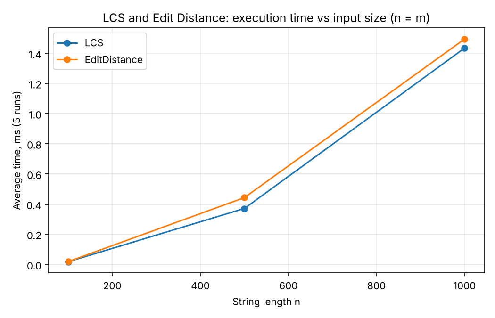
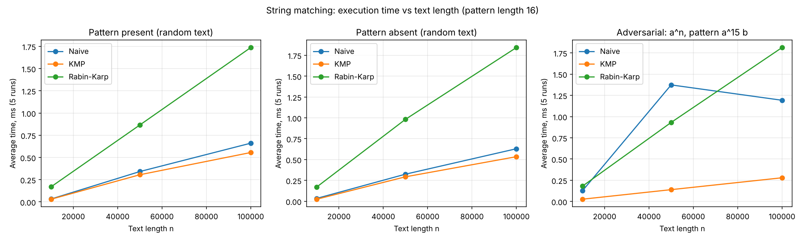
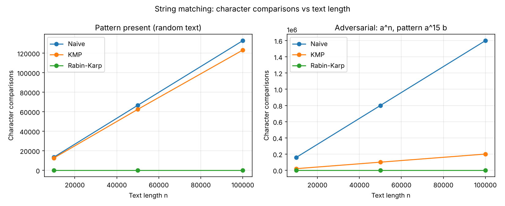
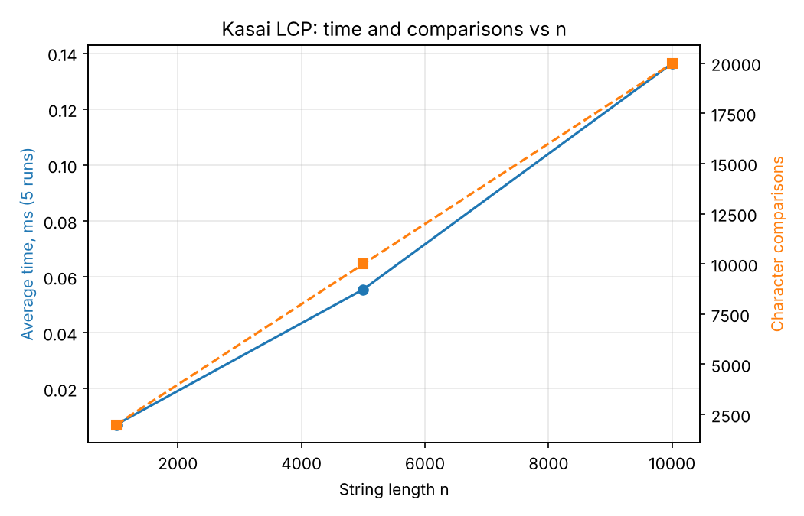

# Assignment 4 — Text Analysis: Dynamic Programming and String Algorithms

Java implementation and experimental comparison of:

| Part | Algorithms |
|---|---|
| A. Dynamic programming | Longest Common Subsequence (LCS), Edit (Levenshtein) Distance |
| B. String matching | Naive, Knuth–Morris–Pratt (KMP), Rabin–Karp |
| C. Advanced | Kasai's algorithm for the LCP array (suffix array given as input) |

All algorithms are implemented from scratch; only the JDK standard library is used
(collections, `java.util.Random`, `System.nanoTime()`). Plots are drawn with a small Python/matplotlib script.

---

## Contents

1. [How to build and run](#1-how-to-build-and-run)
2. [Repository structure](#2-repository-structure)
3. [Problem description and algorithm overview](#3-problem-description-and-algorithm-overview)
4. [Implementation decisions and assumptions](#4-implementation-decisions-and-assumptions)
5. [Complexity analysis](#5-complexity-analysis)
6. [Testing strategy and results](#6-testing-strategy-and-results)
7. [Experimental setup and timing methodology](#7-experimental-setup-and-timing-methodology)
8. [Experimental results (tables and plots)](#8-experimental-results)
9. [Discussion: theory vs experiment](#9-discussion-theory-vs-experiment)
10. [Conclusion: trade-offs](#10-conclusion-trade-offs)

---

## 1. How to build and run

Requirements: **JDK 17+** (developed with JDK 21), **Python 3 + matplotlib** (only for plots).

```bash
# Ubuntu: sudo apt install openjdk-21-jdk python3-matplotlib

./build.sh            # compile everything into ./out
./run-tests.sh        # compile + run all tests (exit code 0 = all passed)
./run-benchmark.sh    # compile + run experiments -> results/*.csv, results/results.md, plots/*.png

java -cp out textanalysis.Main   # short demo of every algorithm
```

Without the scripts (any OS):

```bash
javac -d out $(find src -name "*.java")          # Windows PowerShell: see below
java -cp out textanalysis.tests.TestRunner
java -cp out textanalysis.bench.Benchmark results
python3 scripts/plot_results.py
```

Windows PowerShell compile: `javac -d out (Get-ChildItem -Recurse -Filter *.java src).FullName`

## 2. Repository structure

```
src/main/java/textanalysis/
├── dp/
│   ├── LCS.java                 # LCS table, length, reconstruction
│   └── EditDistance.java        # Levenshtein distance table
├── matching/
│   ├── StringMatcher.java       # common interface + shared conventions
│   ├── NaiveMatcher.java
│   ├── KMPMatcher.java          # LPS (prefix-function) table + search
│   └── RabinKarpMatcher.java    # rolling hash + verification on hash hit
├── suffix/
│   ├── SuffixArray.java         # helper: naive + prefix-doubling construction (input for Kasai)
│   └── Kasai.java               # LCP array in O(n) (+ brute force for verification)
├── util/
│   ├── Counter.java             # operation counters (comparisons, cells, hash hits, collisions)
│   └── RandomStrings.java       # seeded generator, alphabet {a,b,c,d}
├── bench/Benchmark.java         # all experiments, writes CSV + Markdown tables
└── Main.java                    # demo
src/test/java/textanalysis/tests/TestRunner.java   # test suite (plain JDK, no JUnit needed)
scripts/plot_results.py          # results/*.csv -> plots/*.png
results/                         # dp.csv, matching.csv, kasai.csv, results.md
plots/                           # dp_time.png, matching_time.png, matching_comparisons.png, kasai_time.png
```

## 3. Problem description and algorithm overview

### 3.1 Longest Common Subsequence

Given strings `a` (length n) and `b` (length m), find the length of the longest sequence of
characters that appears in both strings in the same order, not necessarily contiguously.

`dp[i][j]` = LCS length of the prefixes `a[0..i)` and `b[0..j)`.

```
dp[0][j] = dp[i][0] = 0
dp[i][j] = dp[i-1][j-1] + 1                 if a[i-1] == b[j-1]
dp[i][j] = max(dp[i-1][j], dp[i][j-1])      otherwise
answer   = dp[n][m]
```

**Why the recurrence is correct.** Look at the last characters of the two prefixes.
*If they are equal*, some optimal LCS ends with that character (if an optimal LCS did not use
it, we could swap its last character for this one without making it shorter), so the answer is
1 + LCS of both prefixes shortened by one. *If they differ*, they cannot both be the last
character of a common subsequence, so at least one of them is unused: the answer is the better
of dropping `a[i-1]` or dropping `b[j-1]`. Both cases only reference smaller prefixes
(optimal substructure), and the same sub-problems are reused many times (overlapping
sub-problems), so filling the table row by row computes every value exactly once.
The actual subsequence is recovered by walking back from `dp[n][m]` (`LCS.subsequence`).

### 3.2 Edit Distance (Levenshtein)

Minimum number of single-character insertions, deletions and substitutions turning `a` into `b`.

```
dp[i][0] = i        (delete i characters)
dp[0][j] = j        (insert j characters)
dp[i][j] = dp[i-1][j-1]                                  if a[i-1] == b[j-1]
dp[i][j] = 1 + min( dp[i-1][j],      // delete a[i-1]
                    dp[i][j-1],      // insert b[j-1]
                    dp[i-1][j-1] )   // substitute a[i-1] -> b[j-1]
```

**Why it is correct.** In an optimal edit script consider what happens to the last
character of `a[0..i)` and of `b[0..j)`. Exactly one of the following holds: `a[i-1]` is
deleted; `b[j-1]` is inserted; or `a[i-1]` is aligned with `b[j-1]` (free if equal, one
substitution otherwise). Each case leaves a smaller independent sub-problem whose optimal
solution must be part of the overall optimum (otherwise we could improve the whole script),
so taking the minimum over the three cases is exact. When the characters are equal, matching
them for free is never worse than the alternatives (`dp[i-1][j-1] <= dp[i-1][j] + 1` and
`<= dp[i][j-1] + 1`), which is why that case has no `min`.

### 3.3 Naive string matching

Try every shift `s = 0 .. n-m`, compare `pattern` with `text[s..s+m)` left to right,
stop at the first mismatch. No preprocessing. After a mismatch, all knowledge about the text is
thrown away and the next shift starts again from `pattern[0]`.

### 3.4 Knuth–Morris–Pratt

**Preprocessing.** `lps[i]` = length of the longest *proper* prefix of `pattern[0..i]` that is
also its suffix. Example: `aabaaab` → `[0,1,0,1,2,2,3]`.

**Search.** `j` = number of pattern characters currently matched. On a match, `i` and `j`
advance; on a full match an occurrence `i-m+1` is reported and `j = lps[m-1]` (allows overlaps).
On a mismatch with `j > 0`, we set `j = lps[j-1]` **without moving `i`**.

**How KMP avoids repeated comparisons.** When a mismatch happens after `j` matched
characters, we already know that the last `j` text characters equal `pattern[0..j)`.
The longest prefix of the pattern that can still be "in progress" is exactly the longest
border of `pattern[0..j)`, i.e. `lps[j-1]`. So instead of moving the window by one and
re-reading text characters (as Naive does), KMP slides the pattern by `j - lps[j-1]` and keeps
the text pointer where it is. The text pointer `i` never moves backwards, so every text
character is compared successfully at most once; each unsuccessful comparison decreases `j`,
and `j` can only decrease as many times as it has increased. Hence at most `2n` comparisons
in the search (we measured 199,985 for n = 100,000 in the adversarial case).

### 3.5 Rabin–Karp

Treat a window of length `m` as a number in base `B = 256` modulo a large prime
`Q = 1,000,000,007`:

```
h(s[0..m)) = (s[0]·B^(m-1) + s[1]·B^(m-2) + … + s[m-1]) mod Q
roll:  h' = ((h − s[i]·B^(m-1)) · B + s[i+m]) mod Q        // O(1) per shift
```

Only windows whose hash equals the pattern hash are compared character by character.

**How Rabin–Karp handles collisions.** Equal hashes do **not** imply equal strings. Every
hash hit is therefore *verified* with a full character comparison; a hit that fails
verification is a *spurious hit* — it is counted (`spurious_hits`) but never reported.
Correctness is thus guaranteed for any `Q`; collisions only cost time. With a prime
`Q ≈ 10^9`, the probability that a random non-matching window collides is about `1/Q`, so the
expected number of spurious hits on 100,000 windows is ≈ 0.0001 (we observed 0). The test
suite deliberately uses `Q = 7` to force many collisions and checks that the result is still
identical to Naive and KMP.

### 3.6 Kasai's LCP algorithm

The **suffix array** `SA` lists the starting positions of all suffixes in lexicographic order.
The **LCP array** stores, for each `i ≥ 1`, the length of the longest common prefix of the
neighbouring suffixes `SA[i-1]` and `SA[i]` (`LCP[0] = 0` by convention). Together `SA + LCP`
describe the structure of all repeats in the string: e.g. `max(LCP)` is the length of the
longest repeated substring, and the number of distinct substrings is `n(n+1)/2 − ΣLCP`.

Example, `banana` (verified by hand, also in the tests):

| i | SA[i] | suffix | LCP[i] |
|---|---|---|---|
| 0 | 5 | a | 0 |
| 1 | 3 | ana | 1 (`a`) |
| 2 | 1 | anana | 3 (`ana`) |
| 3 | 0 | banana | 0 |
| 4 | 4 | na | 0 |
| 5 | 2 | nana | 2 (`na`) |

**Algorithm.** Build `rank = SA⁻¹`. Process suffixes in *text order* `i = 0,1,…,n-1`; compare
suffix `i` with its predecessor `j = SA[rank[i]-1]`, starting not from 0 but from the current
`h`, then store `LCP[rank[i]] = h` and decrease `h` by one.
**Key lemma:** if suffix `i` shares `h > 0` characters with its predecessor, then suffix `i+1`
shares at least `h−1` characters with *its* predecessor (drop the first character of both
suffixes; the shortened predecessor is still smaller than suffix `i+1`, and everything between
them in sorted order shares that prefix too). So `h` never needs to restart from 0.

The suffix array is an *input*. `SuffixArray.buildNaive` (sorting substrings) is used to
cross-check on small strings, and `SuffixArray.build` (prefix doubling, O(n log² n)) produces
the input for the benchmark. Suffix array construction is **never timed**.

## 4. Implementation decisions and assumptions

* **Alphabet:** all experiment strings are drawn uniformly from **{a, b, c, d}** (4 symbols),
  seed **42** (`RandomStrings.ALPHABET`, `RandomStrings.SEED`). A small alphabet produces many
  partial matches, which makes the differences between matching algorithms visible.
* **Indices** are 0-based; matchers return *all* occurrences in ascending order,
  **overlapping occurrences included** (`"aaaaa"`, `"aa"` → `[0,1,2,3]`).
* **Empty pattern → empty list.** Mathematically the empty string occurs at every position
  `0..n`, but for a text-search tool "search for nothing" is not a meaningful query, so all
  three matchers consistently return `[]`. This is documented in `StringMatcher` and tested.
* **Pattern longer than text → empty list** (no window fits). Empty text → empty list.
* **LCS / Edit Distance** keep the full `(n+1)×(m+1)` table: it is needed to reconstruct the
  LCS and makes the recurrence easy to explain. A two-row variant would reduce space to
  O(min(n, m)) if only the value is needed (see §5).
* **Rabin–Karp parameters:** `B = 256`, `Q = 1,000,000,007`, arithmetic in `long`
  (max intermediate value ≈ 6.5·10¹³, no overflow). `B` and `Q` can be changed via the constructor.
* **Kasai** validates that the suffix array has the same length as the string
  (`IllegalArgumentException` otherwise); `LCP[0] = 0`.
* **Operation counting** (`Counter`): character comparisons for matching and Kasai,
  separate preprocessing comparisons for KMP, hash hits and spurious hits for Rabin–Karp,
  filled cells for DP. Counters are incremented inline, which adds a small constant cost
  equally to all algorithms; timings are taken in the same code path.
* **Tests** use a tiny self-written runner (`TestRunner`) so that the project builds with a
  plain JDK and no build tool or internet access.

## 5. Complexity analysis

n = |text| (or |a|), m = |pattern| (or |b|).

| Algorithm | Main operation / recurrence | Best-case time | Worst-case time | Auxiliary space | Justification |
|---|---|---|---|---|---|
| **LCS** | `dp[i][j] = dp[i-1][j-1]+1` if equal, else `max(dp[i-1][j], dp[i][j-1])` | Θ(n·m) | Θ(n·m) | Θ(n·m) (table); Θ(min(n,m)) with two rows, value only | Every one of the n·m cells is filled exactly once with O(1) work, independent of the input contents. Reconstruction adds O(n+m). |
| **Edit Distance** | `dp[i][j] = dp[i-1][j-1]` if equal, else `1+min(del, ins, sub)` | Θ(n·m) | Θ(n·m) | Θ(n·m); Θ(min(n,m)) with two rows | Same table shape and O(1) per cell; base row/column cost O(n+m). |
| **Naive matching** | compare `pattern` with `text[s..s+m)` for every shift s | O(n) — first character mismatches at almost every shift (preprocessing: none) | O((n−m+1)·m) — e.g. `aaaa…a` / `aa…ab` | O(1) (+ output list) | n−m+1 shifts, each costs between 1 and m comparisons. |
| **KMP** | LPS table; on mismatch `j = lps[j-1]`, text pointer never goes back | Preprocessing Θ(m), search Θ(n) | Preprocessing Θ(m), search Θ(n) → **Θ(n+m)** | Θ(m) (LPS table) | Amortised: `i` increases n times; `j` decreases at most as often as it increases → ≤ 2n search comparisons, ≤ 2m preprocessing comparisons. |
| **Rabin–Karp** | rolling hash `h' = ((h − s[i]·B^{m-1})·B + s[i+m]) mod Q`, verify on hash hit | Preprocessing Θ(m); search Θ(n+m) when there are few hits | **Expected** O(n+m); **worst** O(n·m) | O(1) (+ output list) | Each shift costs O(1) for the hash. Verification costs O(m) per hit: with k real matches and few collisions → O(n + k·m). Adversarial inputs (all windows collide, or very many real matches like `aaaa`/`aa`) give O(n·m). |
| **Kasai (LCP)** | `LCP[rank[i]] = h` extended from previous `h−1` | Θ(n) | Θ(n) | Θ(n) (rank array; output LCP also Θ(n)) | `h` increases at most n times in total (bounded by n) and decreases by at most 1 per step (n steps) → ≤ 2n character comparisons. Suffix array is given, so construction is not included. |

**Expected vs worst case (Rabin–Karp).** The O(n+m) bound is an *expected* bound under the
assumption that the hash behaves like a random function, so a non-matching window collides
with probability ≈ 1/Q. The O(n·m) worst case appears when verification is triggered at
almost every shift — either because of many genuine matches or because of deliberately
constructed collisions (or a bad, small modulus — see the `Q = 7` test).

**Theoretical complexity vs measured time.** The table above counts abstract operations
and describes *growth rates*. Measured times (Section 8) are absolute numbers on one machine:
they include constant factors (cost of `%` vs a `char` comparison), memory/cache effects,
JIT compilation and OS noise. They should be compared with the theory by **ratios when n
grows**, not by their absolute values. The machine-independent operation counts in the tables
are the most direct link between the two.

## 6. Testing strategy and results

`./run-tests.sh` runs `TestRunner` (82 checks). Strategy: (1) fixed hand-checked cases
required by the assignment, (2) classic textbook examples with known answers,
(3) **randomized cross-checks** with fixed seeds against an independent method or property.

| Area | Cases |
|---|---|
| LCS | identical strings (6), completely different (0), first/second/both empty (0), `ABCBDAB`/`BDCABA` = 4, `AGGTAB`/`GXTXAYB` = 4 with reconstruction `GTAB`; 200 random pairs: reconstructed string is a subsequence of both, has length = LCS, LCS is symmetric |
| Edit Distance | identical (0), one empty (= length of the other), both empty, substitution `cat→cut` (1), insertion `cat→cats` (1), deletion `cats→cat` (1), `kitten→sitting` (3), `intention→execution` (5), `sunday→saturday` (3); 200 random pairs: symmetry and bounds `|n−m| ≤ d ≤ max(n,m)` |
| String matching | pattern at beginning / middle / end, multiple occurrences (`abracadabra`/`abra` → [0,7]), overlapping (`aaaaa`/`aa`), periodic (`abababab`/`abab`), absent, longer than text, **empty pattern → []**, empty text, pattern = text, single character; KMP LPS table check; Rabin–Karp with `Q = 7` (collisions occur, result still correct); **500 random cases where Naive, KMP, Rabin–Karp (and weak-hash Rabin–Karp) must return identical lists**. Every fixed case also asserts that all three algorithms return the same list. |
| Kasai | `banana` (SA `[5,3,1,0,4,2]`, LCP `[0,1,3,0,0,2]`, verified by hand — table in §3.6), `mississippi` (SA `[10,7,4,1,0,9,8,6,3,5,2]`, LCP `[0,1,1,4,0,0,1,0,2,1,3]`), single character, empty string, `aaaa` → `[0,1,2,3]`; 100 random strings: prefix-doubling SA = naive SA and Kasai LCP = brute-force LCP; wrong SA length is rejected |

Result:

```
RESULT: 82 passed, 0 failed
```

## 7. Experimental setup and timing methodology

| Experiment | Input sizes | Input |
|---|---|---|
| LCS | n = m = 100, 500, 1,000 | two independent random strings of equal length |
| Edit Distance | n = m = 100, 500, 1,000 | **the same pairs** as LCS |
| String matching | text length 10,000, 50,000, 100,000; pattern length 16 | random text; *present* pattern = substring copied from the middle of the text; *absent* pattern = random string re-generated until it does not occur. **Extra** adversarial case: text `a^n`, pattern `a^15 b` |
| Kasai | n = 1,000, 5,000, 10,000 | random string; suffix array built beforehand (not timed) |

* Alphabet `{a,b,c,d}`, `java.util.Random` with seed 42 → fully reproducible inputs.
* For each comparison, Naive, KMP and Rabin–Karp get **exactly the same text and pattern**,
  and the benchmark aborts if their outputs differ.
* **Timing:** `System.nanoTime()` immediately before and after the algorithm call only.
  Input generation, suffix-array construction, absent-pattern checking, console output
  and file writing are all outside the timed regions (results are written only after all
  measurements are done).
* **JIT warm-up:** a global untimed warm-up phase runs every algorithm 40 times, then each
  configuration gets 10 more untimed runs before the **5 timed runs**. The table reports the
  **average** of the 5 runs (min and max are in the CSV files).
* A result "sink" accumulates return values so that the JIT cannot remove the calls as dead code.
* **Operation counts** are taken from one additional untimed run (they are deterministic).
* Measured on: Intel Xeon @ 2.10 GHz (1 vCPU), Linux, OpenJDK 21.0.12. Absolute
  numbers will differ on another machine; rerun `./run-benchmark.sh` to reproduce.

## 8. Experimental results

Raw data: [`results/dp.csv`](results/dp.csv), [`results/matching.csv`](results/matching.csv),
[`results/kasai.csv`](results/kasai.csv); the tables below are generated in
[`results/results.md`](results/results.md).

### 8.1 Dynamic programming

| Algorithm | n = m | Avg time (ms) | DP cells | Result |
|---|---:|---:|---:|---:|
| LCS | 100 | 0.0191 | 10,000 | 64 |
| LCS | 500 | 0.3720 | 250,000 | 326 |
| LCS | 1,000 | 1.4349 | 1,000,000 | 648 |
| Edit Distance | 100 | 0.0197 | 10,000 | 55 |
| Edit Distance | 500 | 0.4441 | 250,000 | 267 |
| Edit Distance | 1,000 | 1.4950 | 1,000,000 | 521 |



### 8.2 String matching (pattern length 16)

| Scenario | Text length | Naive (ms) | KMP (ms) | Rabin–Karp (ms) | Naive comparisons | KMP comparisons (search + LPS) | RK verification comparisons | RK spurious hits |
|---|---:|---:|---:|---:|---:|---:|---:|---:|
| present | 10,000 | 0.0327 | 0.0304 | 0.1702 | 13,435 | 12,521 + 19 | 16 | 0 |
| present | 50,000 | 0.3416 | 0.3056 | 0.8655 | 66,631 | 62,441 + 22 | 16 | 0 |
| present | 100,000 | 0.6606 | 0.5556 | 1.7366 | 132,848 | 123,186 + 17 | 16 | 0 |
| absent | 10,000 | 0.0344 | 0.0246 | 0.1712 | 13,382 | 12,528 + 18 | 0 | 0 |
| absent | 50,000 | 0.3247 | 0.2931 | 0.9824 | 66,821 | 62,584 + 16 | 0 | 0 |
| absent | 100,000 | 0.6295 | 0.5343 | 1.8427 | 132,691 | 123,228 + 17 | 0 | 0 |
| worst case `a^n` / `a^15b` | 10,000 | 0.1256 | 0.0270 | 0.1802 | 159,760 | 19,985 + 29 | 0 | 0 |
| worst case `a^n` / `a^15b` | 50,000 | 1.3729 | 0.1395 | 0.9309 | 799,760 | 99,985 + 29 | 0 | 0 |
| worst case `a^n` / `a^15b` | 100,000 | 1.1921 | 0.2794 | 1.8127 | 1,599,760 | 199,985 + 29 | 0 | 0 |

(Rabin–Karp additionally performs one hash update per shift, ≈ n arithmetic operations, which is
not a character comparison and is not included in the comparison column.)





### 8.3 Kasai's LCP algorithm

| n | Avg time (ms) | Character comparisons | comparisons / n | Max LCP |
|---:|---:|---:|---:|---:|
| 1,000 | 0.0071 | 1,990 | 1.99 | 11 |
| 5,000 | 0.0555 | 9,991 | 2.00 | 11 |
| 10,000 | 0.1364 | 19,988 | 2.00 | 14 |



## 9. Discussion: theory vs experiment

**LCS and Edit Distance — quadratic growth confirmed.** The number of filled cells is
exactly n² (10⁴ → 2.5·10⁵ → 10⁶), independent of the string contents, as the Θ(n·m)
best = worst bound predicts. Time follows: going from n = 500 to n = 1,000 (4× cells) increases
the time by 3.9× (LCS) and 3.4× (Edit Distance); from 100 to 1,000 (100× cells) by ≈ 75×.
The ratio is slightly below the theoretical one at small n because fixed costs (allocation of
the table, loop setup) weigh more for tiny inputs. Both algorithms have practically identical
running times — they share the same table shape and do O(1) work per cell; Edit Distance
does one extra `min` in the mismatch branch. Memory, not time, is the practical limit:
the full table for n = m = 1,000 already holds 10⁶ `int`s (≈ 4 MB).

**String matching on random text — all three are linear, constants decide.**
On random text over 4 letters a mismatch is usually found after 1–2 characters, so Naive does
only ≈ 1.33·n comparisons (132,848 for n = 100,000) — far from its O(n·m) worst case — and
KMP does ≈ 1.23·n. Both grow linearly with n (×10 text → ≈ ×10 comparisons and ≈ ×20 time
here, the time ratio from 10k to 100k being inflated by the sub-0.05 ms values at 10k, which are
close to the timer/noise floor). KMP is slightly faster than Naive thanks to fewer comparisons
and a single forward pass. **Rabin–Karp is the slowest in practice** (≈ 2.5–5× slower) even though
it performed only 16 verification comparisons: each shift costs several `long` multiplications
and two `%` operations, which are much more expensive than one or two `char` comparisons.
This is the clearest example of the difference between asymptotic complexity
(all three are Θ(n) here) and constant factors. Present vs absent patterns differ very little
because a single occurrence adds only m = 16 comparisons; no spurious hits occurred
(expected ≈ n/Q ≈ 10⁻⁴), matching the analysis.

**Adversarial input — the worst cases appear exactly as predicted.**
For text `a^n` and pattern `a^15 b`, every shift of Naive matches 15 characters before
failing: (n − 15)·16 = 1,599,760 comparisons for n = 100,000, i.e. the Θ((n−m+1)·m)
worst case. KMP needs 199,985 ≈ 2n comparisons (its proven bound) plus 29 for the LPS table —
8× fewer than Naive — and is ≈ 4–10× faster. Rabin–Karp is unaffected by the repetitive text
(no hash hits, so no verification) and keeps its linear behaviour; its worst case would require
*many hits*, e.g. pattern `aa` in `aaaa…`, where it verifies every window (O(n·m)). One timing
point (Naive, 50,000 being slower than 100,000) is measurement noise on a 1-vCPU machine —
the comparison counts, which are deterministic, grow perfectly linearly.

**Kasai — linear time confirmed.** The number of character comparisons is ≈ 2n at every size
(1.99n, 2.00n, 2.00n), exactly the bound from the amortised argument (≤ n increases of `h`
plus ≤ n terminating mismatches). Time grows somewhat faster than n (×10 n → ×19 time):
the algorithm accesses `sa[rank[i]-1]` and the string at positions that jump around in memory,
so cache misses become more frequent as the arrays grow — a hardware effect not captured by
the RAM model. The operation count shows that the algorithm itself is linear.

**General remark.** Theoretical complexity predicts *how the work grows*, and the operation
counts follow the predictions almost exactly. Measured time additionally depends on constant
factors (Rabin–Karp's arithmetic), memory hierarchy (Kasai, DP tables), JIT compilation and
noise (sub-millisecond runs). That is why warm-up, repetition and operation counts are part of
the methodology.

## 10. Conclusion: trade-offs

* **LCS vs Edit Distance:** same Θ(n·m) time and space structure; choose by the question asked
  (similarity as shared content vs cost of transformation). The full table enables
  reconstruction; if only the value is needed, two rows reduce memory to O(min(n, m)).
  Quadratic cost makes them suitable for strings of thousands, not millions, of characters.
* **Naive:** simplest, no preprocessing or extra memory, and competitive on random text, but
  degrades to Θ(n·m) on repetitive inputs — unacceptable when input can be adversarial.
* **KMP:** guaranteed Θ(n+m) for any input at the cost of an O(m) table; the best choice for
  single-pattern search when worst-case guarantees matter. It was the fastest in every scenario here.
* **Rabin–Karp:** expected linear, simple to extend to **many patterns of the same length**
  (compare one rolling hash against a set of hashes) and to 2-D matching, but pays a higher
  constant per shift and has an O(n·m) worst case; correctness relies on verifying every hash hit.
* **Kasai:** turns a suffix array into an LCP array in Θ(n) time and Θ(n) memory; the overall
  cost of suffix-structure analysis is dominated by suffix-array construction, not by LCP.
